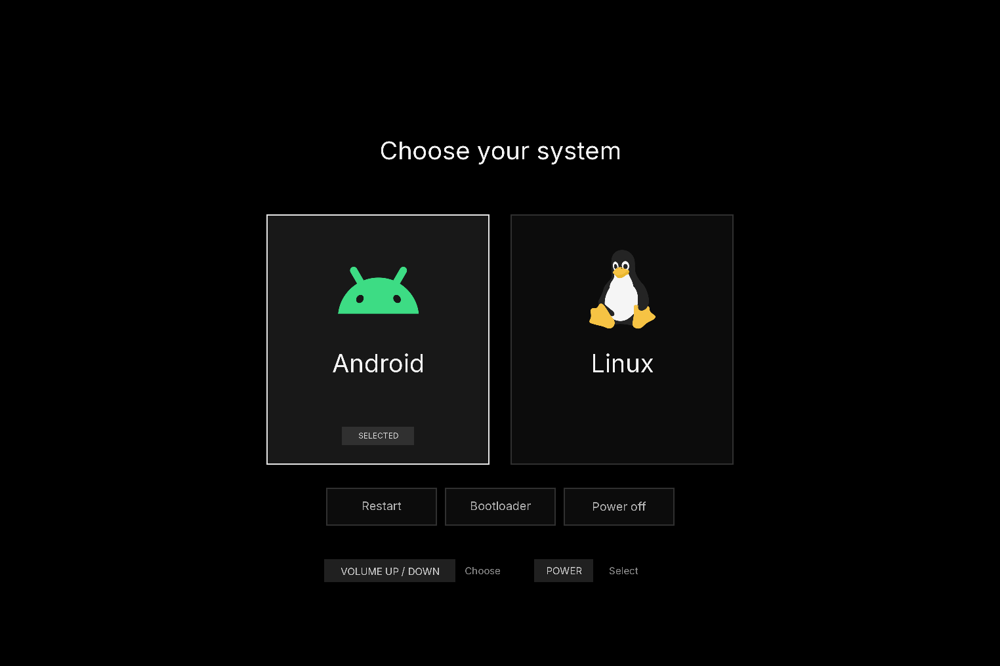

# Xiaomi Pad 6S Pro native boot menu

> **Project Status**  
> This project is still in its **early development stage**. Functionality may be incomplete and build results may contain unknown issues.  
> AI was used for developing this project and writing the readme.md.


A Volume/Power-controlled **Android / Linux** menu for the Xiaomi Pad 6S Pro 12.4, codename **`sheng`**.




**This adds a menu to an already working Android/Linux installation.** For a guide on how to install Linux and set up dual boot, Check out [this awesome guide](https://github.com/alghiffaryfa19/Linux-xiaomi-sheng)

The development version was tested on one tablet. The cleaned-up, parameterized build tools have host tests; they are experimental and have not been hardware-tested on every firmware or RAM/storage variant. 

**I'm not responsible for any bricked devices, you are on your own, flash this at your own risk.**

## Start here

1. Check [requirements and supported layouts](docs/REQUIREMENTS.md).
2. Follow [installation, from backups to the first permanent boot](docs/INSTALL.md).
3. Keep the [restore instructions](docs/RECOVERY.md) with your private backups.
4. If a step fails, use [troubleshooting](docs/TROUBLESHOOTING.md) before changing anything.

The short build sequence, **after the installation guide has collected your own inputs**, is:

```sh
python3 tools/extract_linux.py --boot private/linux-native.img --output private/linux
python3 tools/build_uboot.py --jobs 4
python3 tools/build_menu.py --capture private/capture --linux private/linux
.venv/bin/python tools/verify_arm64.py --directory .build/menu
```

These commands create files on the computer. They do not flash or reboot a tablet.

## What happens to A/B slots?

The normal public build stays on **slot A**. Both menu choices use A's currently selected firmware; choosing Linux does **not** activate B. The installer replaces only the beginning of `boot_a`, preserves its existing tail, and verifies that `boot_b` and all six GPTs are unchanged.

The reference device's **Switch slot** implementation is included separately under [advanced/slot-switch](advanced/slot-switch/README.md). It writes boot-control metadata and needs device/firmware-specific qualification. It is deliberately **off**; a shared model name alone does not qualify another tablet's GPTs or ABL.

## Repository layout

| Path | Purpose |
| --- | --- |
| `src/sheng_menu/` | U-Boot menu, Android handoff and power commands |
| `src/wrapper/` | ARM64 entry shim and guarded Android/DTB handoff |
| `patches/` | Small patch against the pinned upstream U-Boot revision |
| `configs/` | U-Boot configuration and menu environment |
| `assets/` | Current icons, generated artwork and renderer |
| `tools/` | Capture, build, validation, manual install and source-release tools |
| `tests/` | Host tests and a synthetic Android device tree |
| `advanced/slot-switch/` | Separately licensed slot helper, profile generator and synthetic tests |
| `docs/` | Requirements, installation, recovery, development and limitations |
| `vendor/libfdt/` | Upstream libfdt sources with their original licenses |
| `private/` | **Ignored:** your images, captures and backups |
| `.build/` | **Ignored:** downloaded source, objects and candidate images |

## Existing Linux setup

[ianchb/debian-sheng](https://github.com/ianchb/debian-sheng) is the Linux project used during development.

## Development and publishing

```sh
make test                 # standard-library host tests
make test-slot            # synthetic C helper tests; requires a C compiler
python3 tools/check_public.py
python3 tools/make_source_release.py
```

See [DEVELOPMENT.md](docs/DEVELOPMENT.md) for artwork changes, tests and publishing. Upload the source folder or the generated source ZIP, **not the entire original development workspace**.

## Credits and licenses

The project's tooling, tests and documentation use **GNU GPLv3** (`GPL-3.0-only`); see [LICENSE](LICENSE). U-Boot is pinned to official `v2026.10`, commit `5508406582f6f7120dce0c4b3059819a41788db2`. Its runtime integration remains GPLv2-compatible because that build includes GPLv2-only files. See [licensing scope](docs/LICENSING.md) and [NOTICE](NOTICE) for the required exceptions and credits.

**ianchb** - For the linux build this project was build on.
**map220v** – For TWRP, the mainline kernel port and many device-specific adaptations that make Linux run on the Xiaomi Pad 6S Pro (sheng).
**alghiffaryfa19** – For the detailed guide.
